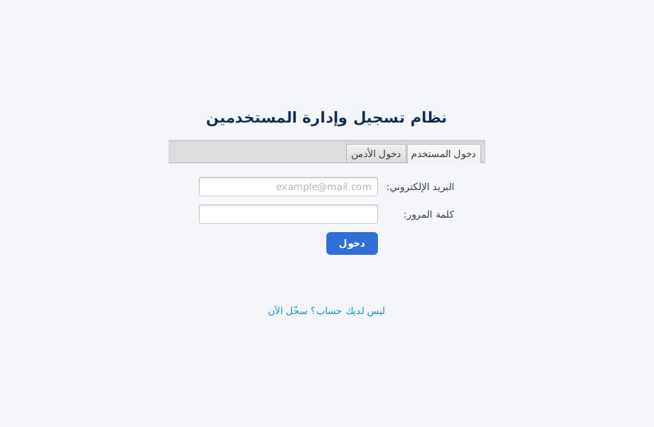
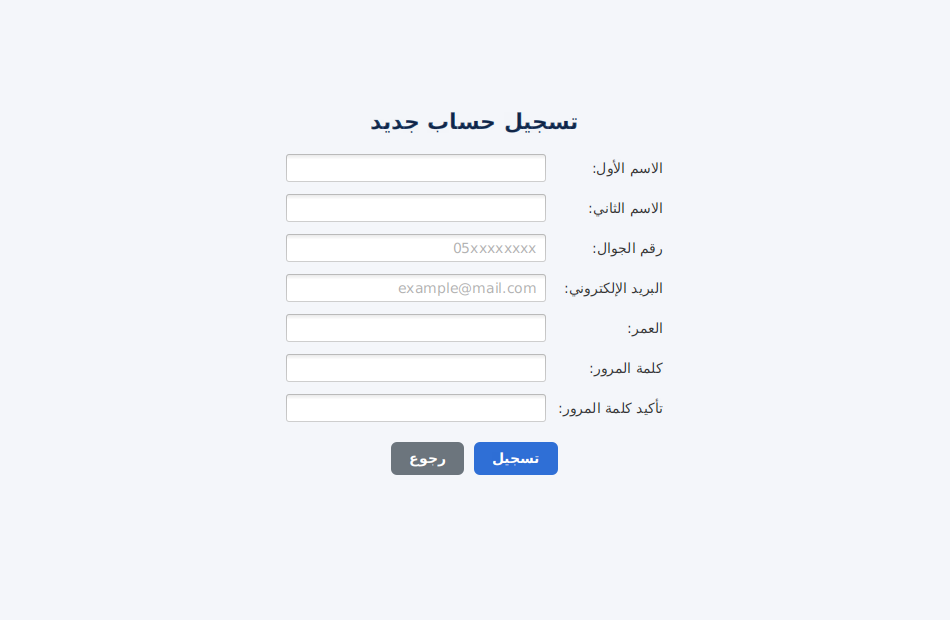
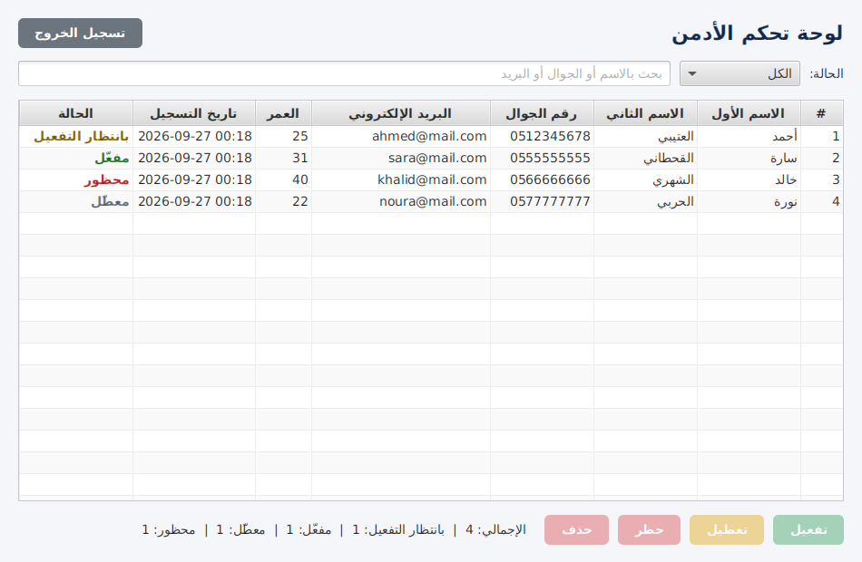

# نظام تسجيل وإدارة المستخدمين (JavaFX)

برنامج سطح مكتب مبني بـ **JavaFX** يتيح:

- **للمستخدمين:** إنشاء حساب بإدخال (الاسم الأول، الاسم الثاني، رقم الجوال، البريد الإلكتروني، العمر) مع كلمة مرور، ثم تسجيل الدخول.
- **للأدمن:** استعراض جميع الحسابات في جدول مع البحث والتصفية حسب الحالة، وتنفيذ العمليات: **تفعيل**، **تعطيل**، **حظر**، و**حذف**.

## حالات الحساب

| الحالة | الوصف | هل يستطيع الدخول؟ |
|---|---|---|
| بانتظار التفعيل | الحالة الافتراضية بعد التسجيل | لا |
| مفعّل | فعّله الأدمن | نعم |
| معطّل | عطّله الأدمن مؤقتاً | لا |
| محظور | حظره الأدمن | لا |

## التشغيل

المتطلبات: JDK 17 أو أحدث، و Maven.

```bash
mvn javafx:run
```

أو من داخل الـ IDE شغّل الصنف `com.example.usermgmt.Launcher`.

**بيانات دخول الأدمن الافتراضية:** اسم المستخدم `admin` وكلمة المرور `admin123`
(معرّفة في `UserService`).

تُحفظ البيانات في الملف `data/users.dat` داخل مجلد التشغيل.

## التحقق من البيانات عند التسجيل

- الاسم الأول والثاني: حروف فقط (2–30 حرفاً).
- رقم الجوال: يبدأ بـ `05` ويتكون من 10 أرقام، ولا يتكرر.
- البريد الإلكتروني: صيغة صحيحة، ولا يتكرر.
- العمر: رقم بين 10 و 120.
- كلمة المرور: 6 أحرف على الأقل، ويجب تطابق التأكيد.

## الاختبارات

```bash
mvn test
```

## هيكل المشروع

```
src/main/java/com/example/usermgmt/
├── App.java              # نقطة التشغيل والتنقل بين الشاشات
├── Launcher.java         # مشغّل للتشغيل من الـ IDE
├── model/                # User و AccountStatus
├── service/              # UserService (التسجيل، الدخول، تغيير الحالة، الحفظ)
└── ui/                   # LoginView, RegisterView, UserHomeView, AdminView
```

## لقطات الشاشة

| تسجيل الدخول | التسجيل | لوحة الأدمن |
|---|---|---|
|  |  |  |
